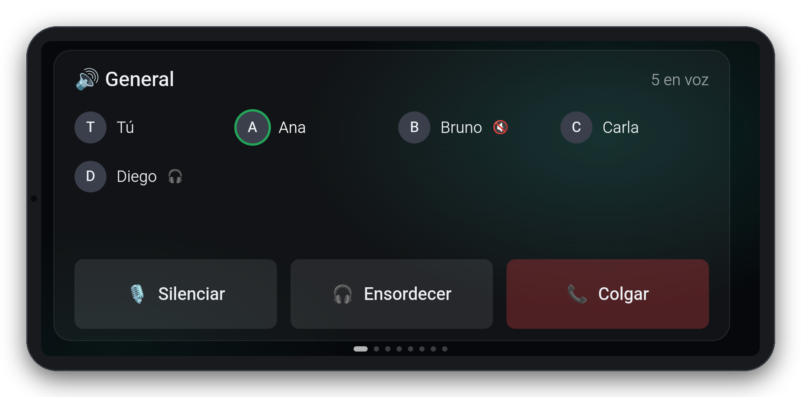
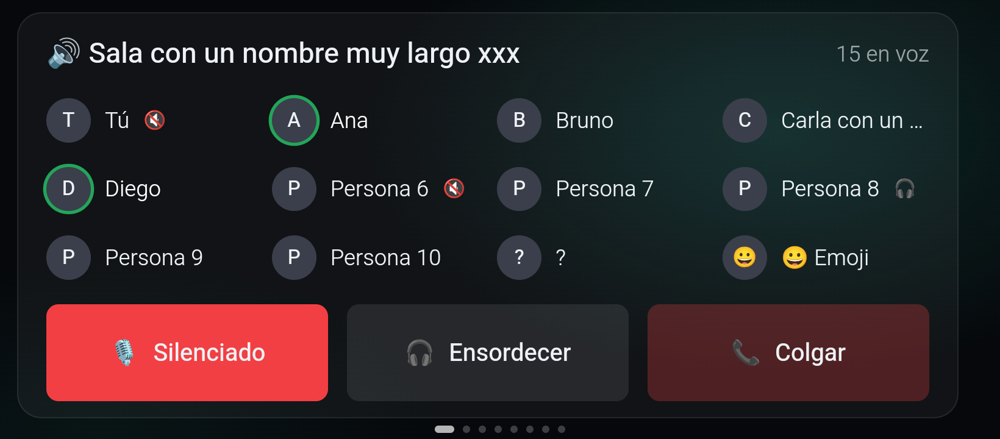
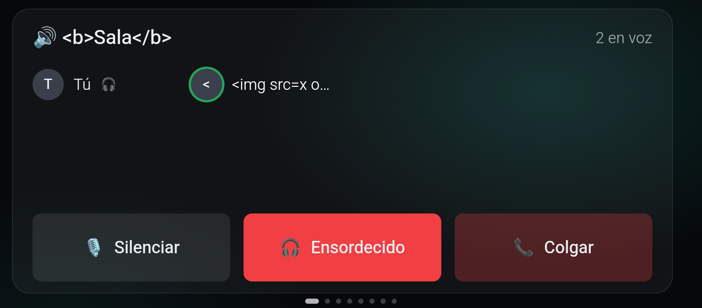
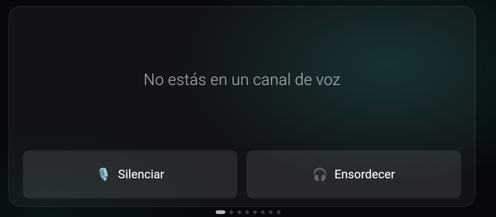
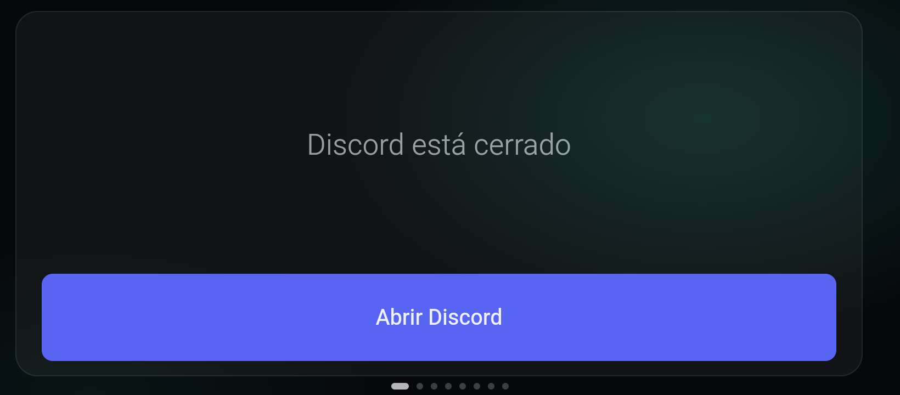
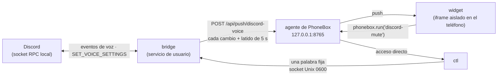

<p align="center">
  
</p>

<h1 align="center">Panel de voz de Discord para PhoneBox</h1>

<p align="center">
  <a href="README.md">English</a> · <b>Español</b>
</p>

<p align="center">
  <b>Mira quién habla en tu canal de voz de Discord y silencia, ensordece o cuelga<br>desde el panel de <a href="https://github.com/ersinkoc/phonebox">PhoneBox</a> de tu escritorio.</b>
</p>

<p align="center">
  <a href="#inicio-rápido"><b>Inicio rápido</b></a> ·
  <a href="#cómo-funciona"><b>Cómo funciona</b></a> ·
  <a href="docs/threat-model.md"><b>Matriz de amenazas</b></a>
</p>

<p align="center">
  <a href="https://github.com/M00n-of-saturn/phonebox-discord-widget/actions/workflows/ci.yml"></a>
  
  
  
  
  <a href="LICENSE"></a>
</p>

<p align="center">
  
</p>
<p align="center"><sub>Funcionando en PhoneBox en un teléfono Android, con datos de demostración. La interfaz puede estar en inglés o en español, a elección al instalar.</sub></p>

## Qué ofrece

| En el teléfono | Qué hace |
|---|---|
| **Canal y contador** | El canal de voz en el que estás y cuántas personas hay (se muestran hasta 12; el total real siempre se cuenta). |
| **Quién habla** | Un aro verde se enciende alrededor de quien habla, en tiempo real. |
| **Silenciados y ensordecidos** | Íconos junto a cada persona, para saber quién te escucha. |
| **Silenciar · Ensordecer · Colgar** | Botones grandes que siguen tu estado real en Discord y se ponen rojos al activarse. |
| **Abrir Discord** | Si Discord está cerrado, un toque lo abre en la PC. |
| **Estado honesto** | "Sin conexión con la PC" si la PC deja de enviar datos durante 15 s: nunca muestra datos viejos como actuales. |

## Inicio rápido

### 1. Requisitos

- Linux con sesión de systemd de usuario, **Node 24** y **pnpm**.
- La aplicación oficial de **Discord** (las versiones Flatpak como Vesktop no exponen el socket local).
- Un llavero del sistema con `secret-tool` (KWallet o GNOME Keyring).
- El agente de [PhoneBox](https://github.com/ersinkoc/phonebox) corriendo en la PC, con el teléfono conectado.

### 2. Crea una aplicación de Discord

1. Abre el [portal de desarrolladores de Discord](https://discord.com/developers/applications) y crea una aplicación.
2. En **OAuth2**, agrega `http://localhost` como dirección de redirección.
3. Ten a mano el **Client ID** y el **Client Secret**. Discord solo permite controlar la voz por RPC a la persona
   dueña de la aplicación y a sus testers, así que usa tu propia cuenta.

### 3. Instala

```sh
git clone https://github.com/M00n-of-saturn/phonebox-discord-widget.git
cd phonebox-discord-widget
pnpm install
pnpm build
pnpm run setup            # pide el Client ID y el Client Secret (oculto) y abre "Autorizar" en Discord
pnpm run install-widget   # agrega la página "Discord" y 4 accesos directos a PhoneBox y activa el servicio
```

La interfaz queda en inglés por defecto. Para tenerla en español, instala con `--lang es`:

```sh
pnpm run install-widget --lang es   # interfaz en español (--lang en para inglés)
```

Solo se aceptan `en` y `es` (también funciona `--lang=es`). `--lang` no se puede combinar con `--uninstall`.

> [!NOTE]
> Usa `pnpm run setup`, no `pnpm setup`: este último es un comando propio de pnpm.
> Ejecútalo en una terminal real, porque lee el secreto sin mostrarlo.

`install-widget` guarda antes una copia de la configuración de PhoneBox en `~/.config/PhoneBox/config.json.pre-discord.bak`.
Para actualizar tras traer cambios: `pnpm build && pnpm run install-widget`.
Reinstalar sin `--lang` mantiene el idioma de la instalación actual (se lee de la unidad de systemd del bridge).
Las instalaciones hechas antes de esta opción eran todas en español, así que siguen en español al reinstalar
(usa `--lang en` para cambiar).
Si el widget muestra "Falta autorizar" (o "Authorization missing" si lo instalaste en inglés), vuelve a ejecutar `pnpm run setup` (Enter mantiene lo guardado).

## Pantallas

<table>
  <tr>
    <td width="50%"><br><b>Canal lleno</b><br><sub>Se muestran 12 personas y el total real arriba; los nombres largos se cortan con puntos suspensivos.</sub></td>
    <td width="50%"><br><b>Los nombres no confiables siguen siendo texto</b><br><sub>Un nombre como <code>&lt;img src=x onerror=…&gt;</code> se dibuja literal, nunca como HTML.</sub></td>
  </tr>
  <tr>
    <td width="50%"><br><b>Fuera de un canal</b><br><sub>Silenciar y ensordecer funcionan antes de entrar.</sub></td>
    <td width="50%"><br><b>Discord cerrado</b><br><sub>Un botón para abrirlo en la PC.</sub></td>
  </tr>
</table>

## Cómo funciona



- **bridge** habla con Discord por su socket local, mantiene un estado validado y lo publica en el agente de
  PhoneBox con un `ttl` de 15 s. Nunca abre un puerto de red.
- **widget** es un único bloque de HTML de 9 KB que solo dibuja ese estado y pide accesos directos por id.
- **ctl** es lo que ejecuta cada acceso directo: envía al bridge una de tres palabras fijas,
  `alternar-silencio`, `alternar-ensordecer` o `colgar`.

## Seguridad y privacidad

| Aspecto | Cómo se maneja |
|---|---|
| Secretos | El Client Secret y el token de refresco viven solo en el llavero del sistema y viajan por stdin. Nunca en archivos, registros, argumentos de procesos ni en el widget. |
| Nombres que vienen de Discord | Se sanean en el bridge, se validan otra vez en el widget y se dibujan solo con `textContent`. `innerHTML`, `eval` y similares están prohibidos y hay pruebas que lo comprueban. |
| Órdenes desde el teléfono | Solo existen tres órdenes fijas. El socket de control es privado de tu usuario (modo 0600). |
| Datos de otras personas | Solo se envía lo que se muestra. Los ids reales de Discord se reemplazan por claves opacas con sal que cambian en cada arranque; sin avatares. |
| Dependencias | Ninguna en ejecución; tres de desarrollo con lockfile y `pnpm audit`. |

La matriz completa, con la prueba que respalda cada mitigación, está en [`docs/threat-model.md`](docs/threat-model.md).

## Desarrollo

```sh
pnpm test        # node:test, sin red ni Discord
pnpm typecheck   # TypeScript estricto
pnpm build       # dist/bridge.js, dist/ctl.js, dist/setup.js, dist/widget.html
```

```
src/
  shared/models/   Modelo del estado de voz, saneado de nombres y validación (lo usan ambos lados)
  bridge/          Corre en la PC: cliente de Discord, llavero y tokens, traductor de estado, publicador, socket de control
  widget/          Corre en el teléfono: cliente de PhoneBox, componentes y estilos
scripts/           Build e instalación o desinstalación en PhoneBox
tests/             Espejo de src/, más un DOM falso, estados de demostración y pruebas de instalación
docs/              Diseño, plan de implementación y matriz de amenazas (en inglés)
```

Criterios: una responsabilidad por clase y carpeta; `widget` y `bridge` dependen de `shared` y nunca uno del otro;
los orígenes de datos y el cliente de PhoneBox se usan a través de interfaces para poder simularlos en las pruebas.

Registros: `journalctl --user -u phonebox-discord-widget`. Solo contienen tipos de evento y códigos, nunca nombres ni tokens.

## Desinstalación

```sh
pnpm run install-widget --uninstall
secret-tool clear service phonebox-discord-widget name client-secret
secret-tool clear service phonebox-discord-widget name refresh-token
```

Después quita la aplicación en Discord → Ajustes de usuario → Aplicaciones autorizadas.

---

## Licencia

[MIT](LICENSE)

---
