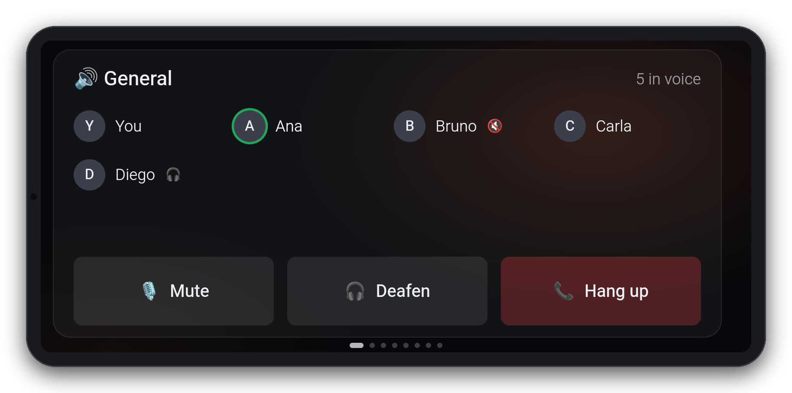
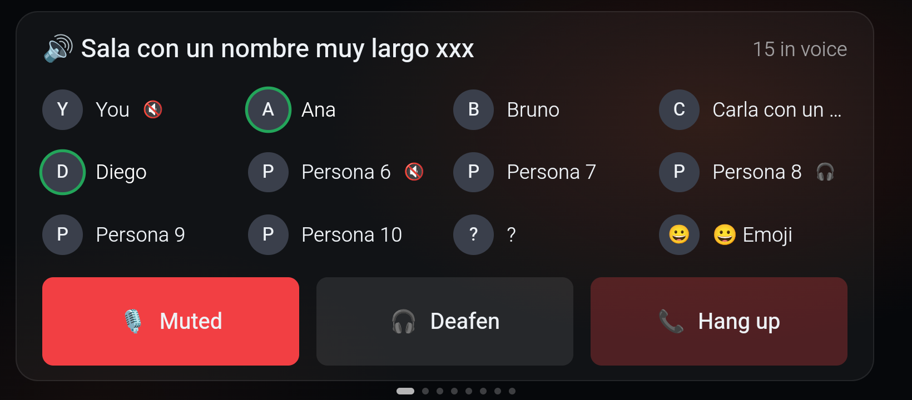
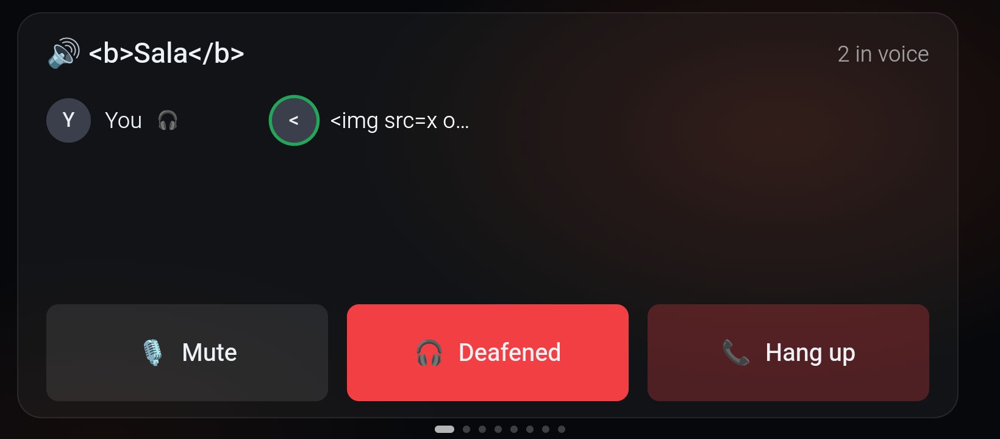
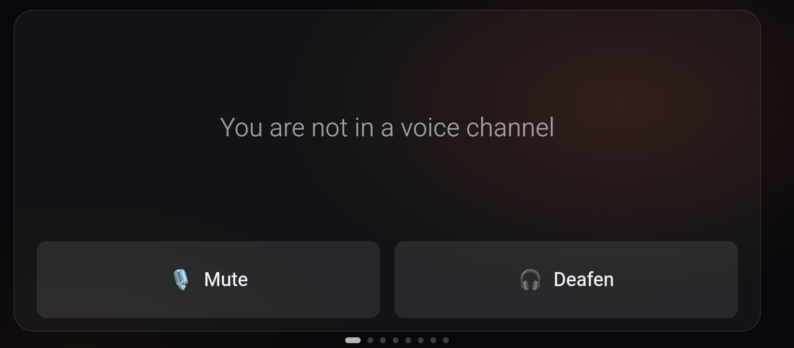
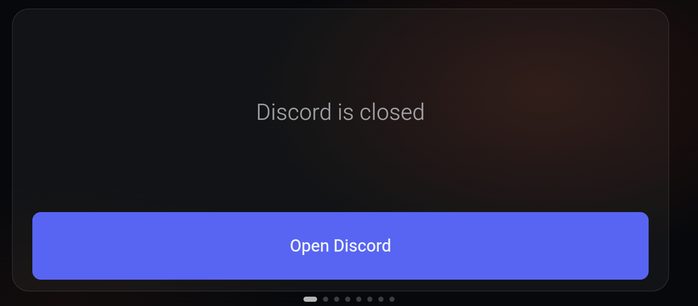
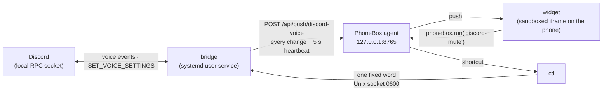

<p align="center">
  
</p>

<h1 align="center">PhoneBox Discord Voice Panel</h1>

<p align="center">
  <b>English</b> · <a href="README.es.md">Español</a>
</p>

<p align="center">
  <b>See who is talking in your Discord voice channel, and mute, deafen or hang up<br>from the <a href="https://github.com/ersinkoc/phonebox">PhoneBox</a> panel on your desk.</b>
</p>

<p align="center">
  <a href="#quick-start"><b>Quick start</b></a> ·
  <a href="#how-it-works"><b>How it works</b></a> ·
  <a href="docs/threat-model.md"><b>Threat model</b></a>
</p>

<p align="center">
  <a href="https://github.com/M00n-of-saturn/phonebox-discord-widget/actions/workflows/ci.yml"></a>
  
  
  
  
  <a href="LICENSE"></a>
</p>

<p align="center">
  
</p>
<p align="center"><sub>Running in PhoneBox on an Android phone, with demo data. The interface is in English or Spanish, chosen at install time.</sub></p>

## What you get

| On the phone | What it does |
|---|---|
| **Channel and count** | The voice channel you are in and how many people are in it (up to 12 shown, the real total always counted). |
| **Who is talking** | A green ring lights up around whoever is speaking, in real time. |
| **Muted and deafened** | Icons next to each person, so you know who can hear you. |
| **Mute · Deafen · Hang up** | Big touch buttons that follow your real Discord state and turn red when active. |
| **Open Discord** | When Discord is closed, one tap opens it on the PC. |
| **Honest status** | "Sin conexión con la PC" if the PC stops sending updates for 15 s, so stale data is never shown as live. |

## Quick start

### 1. Requirements

- Linux with a systemd user session, **Node 24** and **pnpm**.
- The official **Discord** desktop app (Flatpak builds such as Vesktop do not expose the local socket).
- A system keyring with `secret-tool` (KWallet or GNOME Keyring).
- The [PhoneBox](https://github.com/ersinkoc/phonebox) agent running on the PC, with the phone connected.

### 2. Create a Discord application

1. Open the [Discord Developer Portal](https://discord.com/developers/applications) and create an application.
2. In **OAuth2**, add `http://localhost` as a redirect URL.
3. Keep the **Client ID** and **Client Secret** at hand. Discord only grants voice control over RPC to the
   application's owner and its testers, so use your own account.

### 3. Install

```sh
git clone https://github.com/M00n-of-saturn/phonebox-discord-widget.git
cd phonebox-discord-widget
pnpm install
pnpm build
pnpm run setup            # asks for the Client ID and the Client Secret (hidden), then opens "Authorize" in Discord
pnpm run install-widget   # adds the "Discord" page and 4 shortcuts to PhoneBox and starts the service
```

The interface is in English by default. For Spanish, install with `--lang es`:

```sh
pnpm run install-widget --lang es   # Spanish interface (--lang en for English)
```

Only `en` and `es` are accepted (`--lang=es` also works). `--lang` cannot be combined with `--uninstall`.

> [!NOTE]
> Use `pnpm run setup`, not `pnpm setup`: the latter is a built-in pnpm command.
> Run it in a real terminal, since it reads the secret without echoing it.

`install-widget` first saves a copy of your PhoneBox settings to `~/.config/PhoneBox/config.json.pre-discord.bak`.
To update after pulling changes: `pnpm build && pnpm run install-widget`.
A reinstall without `--lang` keeps the language of the current installation (read from the bridge's systemd unit).
Installations made before this option existed have no language recorded, so they switch to English on the next
reinstall unless you pass `--lang es` once.

## Screens

<table>
  <tr>
    <td width="50%"><br><b>Busy channel</b><br><sub>12 people shown, the real total in the corner; long names are cut with an ellipsis.</sub></td>
    <td width="50%"><br><b>Untrusted names stay text</b><br><sub>A name like <code>&lt;img src=x onerror=…&gt;</code> is drawn literally, never as HTML.</sub></td>
  </tr>
  <tr>
    <td width="50%"><br><b>Not in a channel</b><br><sub>Mute and deafen still work before you join.</sub></td>
    <td width="50%"><br><b>Discord closed</b><br><sub>One button to open it on the PC.</sub></td>
  </tr>
</table>

## How it works



- **bridge** talks to Discord over its local socket, keeps a validated state and publishes it to the PhoneBox
  agent with a 15 s TTL. It never opens a network port.
- **widget** is a single 9 KB HTML block that only draws that state and asks for shortcuts by id.
- **ctl** is what each shortcut runs. It sends one of three fixed words to the bridge: `alternar-silencio`,
  `alternar-ensordecer` or `colgar`.

## Security & privacy

| Concern | How it is handled |
|---|---|
| Secrets | Client Secret and refresh token live only in the system keyring, passed through stdin. Never in files, logs, process arguments or the widget. |
| Names from Discord | Sanitized in the bridge, validated again in the widget and drawn with `textContent` only. `innerHTML`, `eval` and friends are banned and tested for. |
| Commands from the phone | Only three fixed commands exist. The control socket is private to your user (mode 0600). |
| Other people's data | Only what is shown is sent. Real Discord ids are replaced by salted opaque keys that change on every start, with no avatars. |
| Dependencies | Zero at runtime; three dev dependencies with a lockfile and `pnpm audit`. |

The full threat matrix, with the test that backs each mitigation, is in [`docs/threat-model.md`](docs/threat-model.md).

## Development

```sh
pnpm test        # node:test, no network or Discord needed
pnpm typecheck   # strict TypeScript
pnpm build       # dist/bridge.js, dist/ctl.js, dist/setup.js, dist/widget.html
```

```
src/
  shared/models/   Voice state model, name sanitizing and validation (used by both sides)
  bridge/          Runs on the PC: Discord client, keyring and tokens, state tracker, publisher, control socket
  widget/          Runs on the phone: PhoneBox client, components and styles
scripts/           Build and PhoneBox install/uninstall
tests/             Mirrors src/, plus a fake DOM, demo states and install tests
docs/              Design, implementation plan and threat model
```

Logs: `journalctl --user -u phonebox-discord-widget`. They contain event types and codes only, never names or tokens.

## Uninstall

```sh
pnpm run install-widget --uninstall
secret-tool clear service phonebox-discord-widget name client-secret
secret-tool clear service phonebox-discord-widget name refresh-token
```

Then remove the app from Discord → User Settings → Authorized Apps.

---

## License

[MIT](LICENSE)

---
